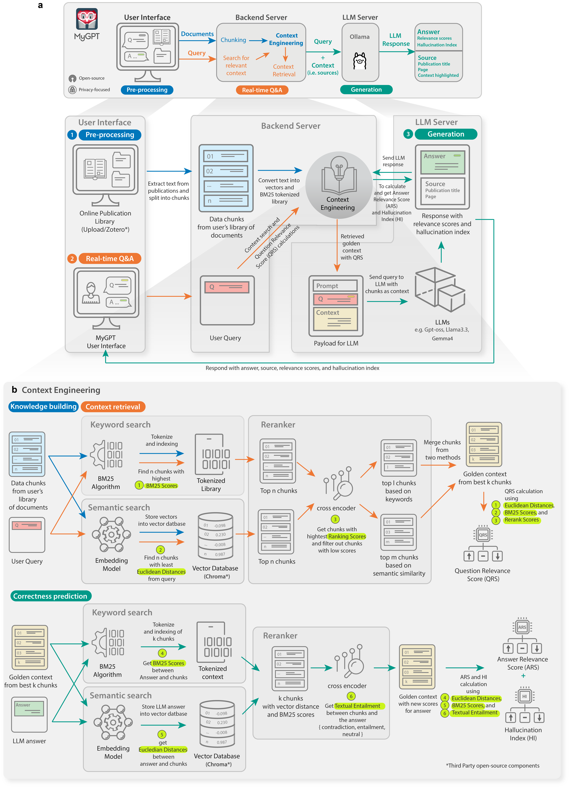
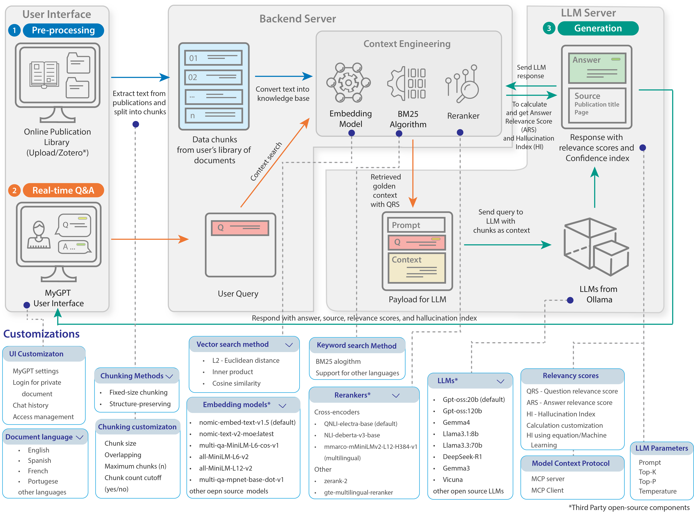

# Module 1 — Install MyGPT and build a library (30 min)

## Objectives

- Get MyGPT (UI, backend) running on your laptop, connected to your models: Ollama on
  your laptop, the St. Jude Ollama server, or the OpenAI API.
- Build a document library from your own files.
- Learn how each pipeline setting changes what MyGPT retrieves and how confident it is.

## Before you start

Finish the prerequisites in [SETUP.md](../SETUP.md), including choosing where the
models run (option A, B or C), then install MyGPT and prepare the BioASQ documents as
described below.

### Install MyGPT

Follow the MyGPT installation guide for your OS, using the **pre-built images** option:

- macOS: <https://github.com/stjude/MyGPT/blob/main/installation/macOS/README.md>
- Linux: <https://github.com/stjude/MyGPT/blob/main/installation/linux/README.md>
- Windows: <https://github.com/stjude/MyGPT/blob/main/installation/windows/README.md>

The guide has you copy `.env_backend.example` to `.env_backend` in the MyGPT folder and
fill in its secrets ([Configure backend secrets](https://github.com/stjude/MyGPT/blob/main/backend/README.md#configure-backend-secrets)).
In the same file, set your model option **before** starting the containers:

| Option | Set in MyGPT's `.env_backend` |
|---|---|
| A. Ollama on your laptop | Nothing to change: `OLLAMA_SERVER=http://host.docker.internal:11434` and `OPENAI_API_KEY=` (empty) |
| B. St. Jude Ollama server | `OLLAMA_SERVER=<St. Jude Ollama server URL>`, and leave `OPENAI_API_KEY=` empty |
| C. OpenAI API | `OPENAI_API_KEY=<your key>` ([OpenAI LLMs](https://github.com/stjude/MyGPT/blob/main/backend/README.md#openai-llms)) |

With a non-empty `OPENAI_API_KEY`, MyGPT switches to OpenAI mode: the model pickers show
only `gpt-6-luna` and the OpenAI embedding models. Keep the key in `.env_backend` only,
never in `.env_frontend`, a screenshot or Git.

If MyGPT is already running when you change `.env_backend`, restart it so the new value
is loaded:

```bash
cd MyGPT/installation/macOS/prebuilt_images   # use your OS folder
bash stop_docker.sh && bash run_docker.sh
```

On Windows, run `docker compose down` then `docker compose up -d frontend` in the folder
that holds MyGPT's `docker-compose.yml`.

Create a backend user for signing in to MyGPT and the API in modules 2–4:

```bash
cd MyGPT/installation/macOS/prebuilt_images   # use your OS folder
bash create_superuser.sh
```

Check that the username and password work at <http://localhost:8000/admin/>.

### Get the workshop files

Clone this repository so you can access the BioASQ inputs and workshop materials:

```bash
git clone https://github.com/stjude-c3d/MyGPT-workshop.git
cd MyGPT-workshop
```

### Prepare documents

The BioASQ PDFs and test questions are included in `data/BioASQ/`. Upload the PDFs in
`data/BioASQ/pdfs/` when creating your library. The test questions are in
`data/BioASQ/questions_all_164.csv`.

Choose the embedding model under **Upload → Advanced** when creating the library:
`nomic-embed-text` for options A and B, `text-embedding-3-small` for option C. It can't
be changed after the library is built.

| Time | Activity |
|---|---|
| 0–5 min | Check that the stack is running |
| 5–15 min | Build the library with default settings |
| 15–28 min | Settings experiment ([worksheet](settings_experiment.md)) |
| 28–30 min | Checkpoint |

## Concepts

MyGPT has three parts: a **React UI**, a **Django backend** that does chunking,
embedding, retrieval and scoring, and a **model server** for the LLM and embeddings:
Ollama on your laptop, the St. Jude Ollama server, or the OpenAI API. Building a library
runs a document through the retrieval pipeline. At question time, MyGPT retrieves
relevant chunks, generates an answer, and scores its relevance and hallucination risk.



### Pipeline settings and their effects



| Setting | Where | What it controls | Typical effect of changing it |
|---|---|---|---|
| **Chunking method** | Upload → Advanced | Fixed-size, or recursive (keeps document structure) | Recursive keeps sections whole; fixed-size is more predictable |
| **Chunk size** | Upload → Advanced | Characters per chunk (recommended: 1000) | Smaller chunks give precise hits but less context per hit; larger chunks dilute the match |
| **Chunk overlap** | Upload → Advanced | Characters shared between neighbouring chunks | Overlap stops answers being cut in half at chunk edges, at the cost of a bigger index |
| **Embedding model** | Upload → Advanced | How text becomes vectors (`nomic-embed-text`, `bge-m3`, `MedCPT`, …) | The biggest effect on retrieval quality; use a multilingual model for non-English documents. **Can't be changed after the library is built** |
| **Distance function** | Upload → Advanced | Cosine, L2 or inner product for semantic search | Changes the distance scale, so QRS/ARS cutoffs must match it |
| **BM25** | Upload → Advanced | Adds keyword search alongside vector search | Helps with gene names, IDs and acronyms that embeddings miss |
| **Reranker** | Upload → Advanced / chat settings | Cross-encoder that re-orders retrieved chunks | Better precision, slower answers |
| **Max chunks (k)** | Chat settings | Number of chunks passed to the LLM | More context, but more noise and slower generation |
| **QC best / worst** | Chat settings | Distance range mapped to QRS 100 → 0 | Raising QCworst lets weaker matches through ([FAQ 18](https://github.com/stjude/MyGPT/blob/main/FAQs.md)) |
| **LLM, temperature, top-k/p** | Chat settings | Generation model and creativity | Low temperature for factual Q&A |

The pre-calculated QC/AC cutoffs for each embedding model are in the
[QRS-ARS-cutoff README](https://github.com/stjude/MyGPT-evaluations/blob/main/QRS-ARS-cutoff/README.md).

## Hands-on

### Step 1 — Check the stack (5 min)

```bash
docker ps                          # MyGPT frontend, backend and database should be "Up"
```

Then check your model option:

| Option | Check | Expect |
|---|---|---|
| A. Ollama on your laptop | `curl -s http://localhost:11434` then `ollama list` | "Ollama is running"; `nomic-embed-text` and `llama3` (or `gpt-oss`) listed |
| B. St. Jude Ollama server | `curl -s <server URL>` then `curl -s <server URL>/api/tags` | "Ollama is running"; `nomic-embed-text` and `llama3` in the model list |
| C. OpenAI API | The LLM picker in MyGPT's chat settings | Only `gpt-6-luna` is offered |

Open the MyGPT UI (the URL is printed by `run_docker.sh`, usually
<http://localhost:3000> or <http://localhost>) and sign in.

### Step 2 — Build a baseline library (10 min)

1. Click **Upload / Create library**.
2. Name it `workshop-library-A`; module 2 will use this name in `.env`.
3. Choose **Advanced settings** and use the baseline values:
   - Chunking: fixed-size, **1000** characters, overlap **Yes**
   - Embedding model: **nomic-embed-text** (option C: **text-embedding-3-small**; MyGPT
     calibrates it on first use, so the first upload takes longer)
   - BM25: **on**, reranker: **qnli-electra-base (default)**
4. Upload your documents and wait until indexing finishes.
5. Ask 3 questions from `data/BioASQ/questions_all_164.csv`, or
  your own. Note the QRS, ARS and HI for each.

### Step 3 — Settings experiment (13 min)

Work through [settings_experiment.md](settings_experiment.md). Build **one** extra
library with one setting changed, ask the same questions, and record the scores.
Change one variable at a time, so any difference comes from that setting. With option C,
compare `text-embedding-3-small` with `text-embedding-3-large` instead of
`nomic-embed-text` with `bge-m3`.

## Checkpoint

- [ ] `workshop-library-A` appears on the MyGPT home page with all your documents.
- [ ] One on-topic question gives QRS > 50 and cites your documents.
- [ ] One off-topic question gives low QRS and high HI. (e.g. Who are the keynote spearkers at the KIDS26 at St. Jude?)
- [ ] Your worksheet table has at least one row comparing two settings.

## Troubleshooting

| Symptom | Fix |
|---|---|
| UI loads but upload fails | Backend not ready. Run `docker logs <backend-container>` and wait for migrations to finish |
| `connection refused` on port 11434 (option A) | Start the Ollama app, or run `ollama serve` |
| St. Jude server unreachable (option B) | Connect to St. Jude Wi-Fi, or turn on Cloudflare if you're off-site. Then check the URL in `.env_backend` (`OLLAMA_SERVER`) and test it with `curl`; restart MyGPT after any change |
| OpenAI errors: authentication, quota or billing (option C) | Check `OPENAI_API_KEY` in `.env_backend` and that API billing is enabled; MyGPT reports the error and does not fall back to Ollama |
| Model pickers show only OpenAI models | `OPENAI_API_KEY` is set. For option A or B, empty it and restart MyGPT |
| Changed `.env_backend` but nothing happened | Restart MyGPT with `stop_docker.sh` then `run_docker.sh`; a plain container restart doesn't reload the file |
| Indexing is very slow | Give Docker more CPU/RAM; use fewer or smaller documents; use `nomic-embed-text` |
| QRS is always 0 | Embedding model and QC cutoffs don't match. Use defaults or raise QCworst ([FAQ 18](https://github.com/stjude/MyGPT/blob/main/FAQs.md)) |
| Scanned PDFs return nothing | MyGPT only extracts the text layer. Run OCR first |

## Going further

- MyGPT FAQs 19, 40 and 41 (library options and recommended settings):
  <https://github.com/stjude/MyGPT/blob/main/FAQs.md>
- Import a Zotero collection as a library instead of uploading files.
